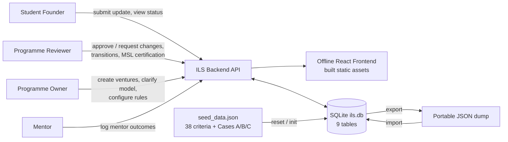
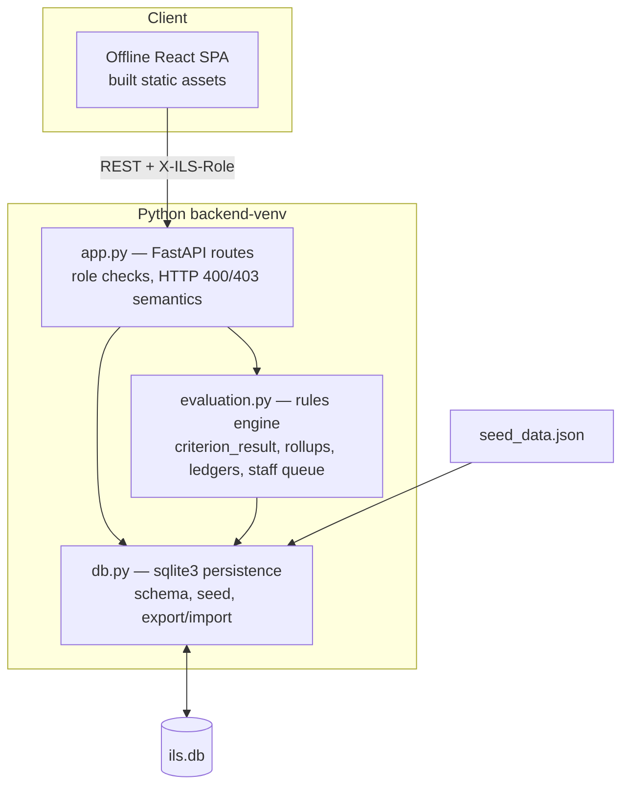
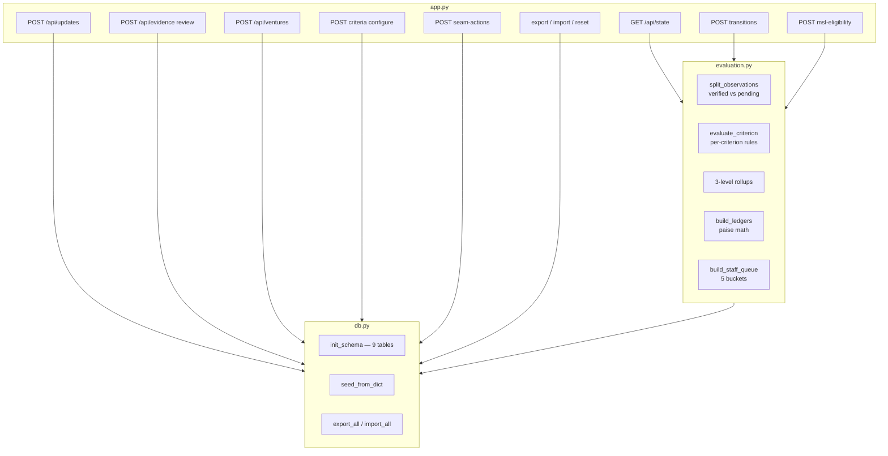

# ILS Venture Progress & Readiness — System Architecture

Frozen-spec implementation: `CONTEXT.md` + `docs/adr/0001-0003`.
Code: `backend/` (FastAPI + stdlib `sqlite3`, no ORM). Tests: 131 backend/stage, 23 frontend, 124 audit.

Companion hand-drawn illustrations (小黑 style): `illustrations/shot-list.md` + `illustrations/prompts.md`.

## 1. System context



Demo-only auth seam: every role check reads the `X-ILS-Role` header. Explicitly not
production authentication.

## 2. Containers



| Container | Tech | Responsibility |
|---|---|---|
| `app.py` | FastAPI, uvicorn | HTTP contract, role gating, server timestamps, audit writes |
| `evaluation.py` | Pure Python | All derived state: never stored, always recomputed from APPROVED evidence |
| `db.py` | stdlib `sqlite3` | 9-table schema, `seed_from_dict`, `export_all` / `import_all` |
| `seed_data.json` | Canonical JSON | 38 criteria, 3 cases, business lines, evidence, observations, historical decisions |
| Frontend | Offline React (built) | `GET /api/state` rendering only; no business logic client-side |

## 3. Backend components



## 4. Core flows

### 4.1 Claim → proof → supersession (AT-02 / AT-03A / AT-13A / AT-13B)

```mermaid
sequenceDiagram
    participant F as Founder
    participant API as app.py
    participant DB as SQLite
    participant ENG as evaluation.py
    participant R as Reviewer
    F->>API: POST /api/updates (claimed_metrics_json verbatim)
    API->>DB: evidence UNREVIEWED + period observations
    R->>API: POST /api/evidence/A-E01/review APPROVED
    API->>DB: evidence_status=APPROVED, server reviewed_at, history row
    API->>ENG: recompute (APPROVED observations only)
    ENG-->>API: L0L1-AIB2C-2 = NOT_MET (8 < 10), sign-ups = UNKNOWN
    F->>API: POST /api/updates A-E02 (11 WAU, supersedes A-E01-W2)
    Note over ENG: while UNREVIEWED: verified stays 12,8 + Pending Correction
    R->>API: review A-E02 APPROVED
    API->>ENG: atomic supersession Week 2 only
    ENG-->>API: readings 12,11 = MET; Week 1 intact; A-E01-W2 in history
```

Rules enforced: supersession activates **only** on `APPROVED`; `CHANGES_REQUESTED`
writes history + staff-queue follow-up and changes nothing else.

### 4.2 Transitions vs MSL certification (AT-09 – AT-11)

- `STANDARD_ADVANCEMENT`: sequential step only (`Level 0→1`, `Level 1→2`),
  `model_resolution_status == CONFIRMED`, every required gate + qualitative
  criterion `== MET`; else `400 + blocking_reasons[]`. Zero waiting rule on success.
- `DIRECT_ENTRY`: immediate placement at Level 1 or Level 2 with reviewer + server timestamp + criteria snapshot. A target below the known current level is rejected with `400` before any write. Case C keeps its historical imported Level 2 decision.
- `POST …/msl-eligibility`: same CONFIRMED gate over `MSL_COMMON` + applicable
  `MSL_MODEL_SPECIFIC`; imported `Eligible for MSL` (Cases B, C) is preserved
  provenance, never recomputed, never erased by fundraising preference.

## 5. Data model (9 tables)

`ventures` (7 independent state columns + provenance, isolated `historical_traction_*`)
→ `venture_business_lines` (track_role, candidate/approved model) →
`criteria_catalog` (38 rows; `BUSINESS_LINE` vs `VENTURE` scope; criterion-aware configure validation; incomplete or invalid rules = BLOCKED) →
`progress_updates` (immutable claims, verbatim `claimed_metrics_json`) →
`evidence_records` (`evidence_status`, `ledger_bucket`, `parent_evidence_id`, integer paise) →
`evidence_observations` (period-scoped, `supersedes_observation_id`) →
`evidence_review_history` / `transition_decisions` / `msl_eligibility_decisions` (immutable audit logs).

Money rule: stored, summed, exported and returned in **integer paise** end-to-end;
Rupee strings are display-only. Historical baselines are isolated, never summed.
Unapproved obligations are `None / Unknown` in verified math — never coerced to 0.

## 6. Role matrix (demo seam)

| Endpoint | Owner | Reviewer | Mentor | Student |
|---|---|---|---|---|
| `GET /api/state` | ✓ | ✓ | ✓ | ✓ |
| `GET /api/export` | ✓ | ✓ | 403 | 403 |
| `POST /api/ventures`, import, reset | ✓ | ✓ | — | 403 |
| `POST /api/updates` | ✓ | ✓ | ✓ | ✓ (201; recognized demo role required) |
| `POST /api/evidence/{id}/review` | 403 | ✓ | 403 | 403 |
| `POST …/transitions`, `…/msl-eligibility` | 403 | ✓ | 403 | 403 |
| `POST /api/criteria/{id}/configure` | ✓ | 403 | 403 | 403 |
| `CLARIFY_MODEL` | ✓ | 403 | 403 | 403 |
| `LOG_MENTOR_OUTCOME` | ✓ | ✓ | ✓ | 403 |

## 7. Deployment & environments

- Local only: `backend-venv`, `uvicorn backend.app:app`, `ils.db` auto-created from
  `seed_data.json` on first request.
- Env overrides: `ILS_DB` (database path), `ILS_SEED` (seed file path).
- Tests use an isolated `tmp_path / ils_test.db` per case via `ILS_DB` monkeypatching.
- No migrations framework: schema is `CREATE TABLE IF NOT EXISTS` + canonical reseed.

## 8. What the illustrations cover

The formal diagrams above stay precise. The five small companion pieces
(`illustrations/`) translate the five cognitive anchors — Claim≠Proof,
Demand-Bar≠Level-complete, no-double-count chains, atomic supersession, seven
independent drawers — into one-idea hand-drawn metaphors, per the
ian-xiaohei-illustrations skill workflow.
